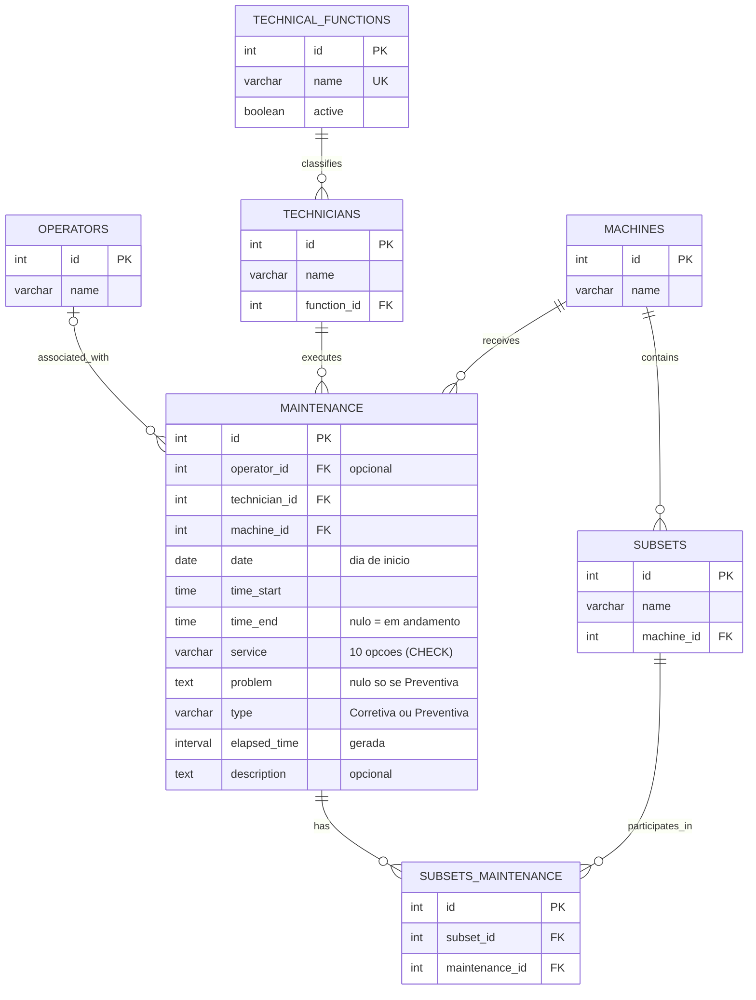

# CLAUDE.md — Maintenance Software | Contexto, arquitetura e regras de trabalho

> **Estado do contexto:** 13 de novembro de 2026.  
> **Idioma de comunicação:** português brasileiro.  
> **Idioma preferencial dos identificadores técnicos:** inglês (`snake_case` no banco; convenções idiomáticas de Python no código).  
> **Natureza do documento:** contrato de colaboração e referência de decisões de domínio. Não substitui a inspeção do repositório nem a confirmação do esquema efetivamente instalado no PostgreSQL.

## 1. Instruções prioritárias para o Claude

1. **Atue como engenheiro de software sênior que orienta um desenvolvedor júnior.** Não entregue apenas código: explique o raciocínio, os conceitos de Python/SQLAlchemy/PostgreSQL, as causas dos erros e os trade-offs arquiteturais. Evite explicações excessivamente superficiais.
2. **Não altere o banco de dados por conta própria.** O proprietário do projeto realiza manualmente a criação, exclusão e alteração de tabelas e constraints. Não execute `CREATE`, `ALTER`, `DROP`, `TRUNCATE`, migrações Alembic, `Base.metadata.create_all()`, `Base.metadata.drop_all()` nem comandos destrutivos ou de escrita contra o banco real sem autorização explícita e específica. Pode redigir SQL para revisão humana quando solicitado.
3. **Reconfirme o estado do banco antes de afirmá-lo.** Em 13 de novembro de 2026, o esquema de sete tabelas foi conferido no catálogo do banco `cmms`, e os Models e repositories foram alinhados a ele (seção 6.2). Isso descreve aquela data: não presuma que banco e Models continuam iguais sem inspecionar.
4. **Não introduza entidades `Intervention`, `Intervencao`, `Incident`, `Incidencia` ou tabelas de associação de técnico/operador com manutenção.** Essas alternativas foram consideradas e descartadas após validação das regras com o cliente. Também não inclua `components` no escopo atual.
5. **Respeite estritamente as cardinalidades aprovadas** (seção 4). Mudanças só mediante nova decisão explícita do usuário.
6. **Não renomeie tabelas ou colunas silenciosamente.** O esquema aprovado utiliza `maintenance` (singular), `subsets`, `subsets_maintenance` e `technical_functions`, mesmo que outras opções de inglês pareçam mais naturais.
7. **Separe fatos confirmados de hipóteses.** Inspecione o código antes de afirmar que uma classe, teste, rota, migração ou funcionalidade existe. Se houver divergência entre código, banco e este documento, apresente-a e peça uma decisão, sem corrigir silenciosamente.
8. **Prefira mudanças pequenas, testáveis e justificadas.** Reutilize o `GenericRepository` existente quando apropriado. Não reescreva a arquitetura inteira nem adicione frameworks por iniciativa própria.
9. **Proteja dados e credenciais.** Não imprima senhas, tokens, URLs de conexão com credenciais ou conteúdo de `.env`. Não execute testes que escrevam no banco real. Para testes de persistência, utilize um banco PostgreSQL de testes isolado e autorizado.
10. **Ao terminar uma tarefa, apresente:** arquivos alterados, justificativa das mudanças, testes realizados e seus resultados, pendências e quaisquer ações SQL que o usuário deverá executar manualmente.

## 2. Objetivo do produto

Desenvolver um **CMMS (Computerized Maintenance Management System)** voltado à gestão de manutenção industrial. A aplicação web deve organizar e relacionar dados de máquinas, subconjuntos, técnicos, operadores e manutenções, permitindo consultas confiáveis e, futuramente, indicadores para apoiar a tomada de decisão da gestão de manutenção.

Objetivos funcionais de alto nível:

- Cadastrar e consultar máquinas e seus subconjuntos.
- Cadastrar operadores e técnicos; vincular técnicos a funções técnicas previamente cadastradas.
- Registrar manutenções vinculadas a uma máquina, um técnico e, opcionalmente, um operador.
- Associar vários subconjuntos à mesma manutenção e permitir que um subconjunto apareça em várias manutenções.
- Manter integridade referencial e histórico consistente, permitindo evolução posterior para APIs, interface web e análises de manutenção.

**Não considerar já implementados:** dashboards, métricas de confiabilidade, autenticação, ordens de serviço, intervenções, componentes, gestão de estoque, planejamento preventivo, frontend funcional ou endpoints específicos. São possíveis evoluções, não escopo aprovado desta etapa.

## 3. Tecnologias e arquitetura

### 3.1 Stack definida ou prevista

| Camada | Tecnologia | Situação conhecida |
| --- | --- | --- |
| Linguagem backend | Python | Definida e utilizada |
| ORM | SQLAlchemy (mapeamento declarativo, `Mapped`, `mapped_column`, `relationship`, `Session`) | Em desenvolvimento e estudo |
| Banco relacional | PostgreSQL | Definido; atualização manual sob responsabilidade do usuário |
| API HTTP | FastAPI | Planejado; implementação atual não verificada |
| Schemas de transporte | Pydantic | Planejado/estudado; implementação atual não verificada |
| Frontend | HTML, CSS, JavaScript; framework apenas se justificado | Futuro; não presumir implementação |
| Testes | Preferir pytest e PostgreSQL de testes, se disponíveis | Cobertura atual não verificada |

### 3.2 Arquitetura desejada

Arquitetura em camadas, com **Repository Pattern**, **Service Layer** e injeção de dependências quando fizer sentido:

```text
API / HTTP (FastAPI, futuramente)
        ↓
Schemas de entrada e saída (Pydantic)
        ↓
Services / casos de uso / regras de negócio
        ↓
Repositories / persistência / consultas
        ↓
SQLAlchemy Models + Session
        ↓
PostgreSQL
```

Responsabilidades:

- **Model ORM:** representa tabelas, atributos, foreign keys, relacionamentos e restrições mapeáveis.
- **Repository:** encapsula operações de persistência e consultas; não decide regras de negócio.
- **Service:** valida regras de negócio, coordena repositories, define casos de uso e o limite transacional.
- **Schema:** valida/serializa dados de entrada e saída; não substitui Model nem Service.
- **API:** traduz HTTP em chamadas de casos de uso e respostas; não deve conter SQL ou lógica de negócio complexa.
- **Persistence/config:** configura engine, session factory, conexões e infraestrutura; evitar acoplamento indevido.

### 3.3 Estrutura de diretórios relatada anteriormente

A árvore abaixo é **aproximada** e deve ser confirmada no repositório real:

```text
cmms/
├── backend/
│   ├── api/
│   ├── app/
│   │   ├── models/
│   │   └── persistence/
│   │       ├── config.py
│   │       └── engine.py
│   ├── repositories/
│   ├── schemas/
│   └── services/
├── docs/
│   └── requirements.md
└── frontend/
```

Não criar/mover diretórios só para reproduzir esta árvore. Inspecionar primeiro os imports e o layout existente.

## 4. Modelo relacional aprovado com o cliente — fonte de verdade de domínio

### 4.1 Tabelas: **exatamente sete no escopo atual**

1. `public.machines`
2. `public.subsets`
3. `public.operators`
4. `public.technical_functions`
5. `public.technicians`
6. `public.maintenance`
7. `public.subsets_maintenance`

Não adicionar `interventions`, `components`, `maintenance_technicians`, `maintenance_operators` ou `maintenance_machines` ao modelo atual.

### 4.2 DER (Mermaid)



### 4.3 Cardinalidades e regras exatas

- `technical_functions (1) → (N) technicians`: cada técnico tem **exatamente uma** função cadastrada; uma função pode ter zero ou muitos técnicos.
- `operators (1) → (N) maintenance`: cada manutenção tem **zero ou um** operador (`operator_id NULL` permitido); um operador pode aparecer em várias manutenções.
- `technicians (1) → (N) maintenance`: cada manutenção tem **exatamente um** técnico (`technician_id NOT NULL`); um técnico pode aparecer em várias manutenções.
- `machines (1) → (N) maintenance`: cada manutenção pertence a **exatamente uma** máquina (`machine_id NOT NULL`); uma máquina pode receber várias manutenções.
- `machines (1) → (N) subsets`: cada subconjunto pertence a **exatamente uma** máquina (`machine_id NOT NULL`); uma máquina pode conter vários subconjuntos.
- `maintenance (N) ↔ (N) subsets`: uma manutenção pode agregar vários subconjuntos; um subconjunto pode constar em várias manutenções. Implementação física: `subsets_maintenance`, com duas foreign keys.
- O registro em `subsets_maintenance` pertence a uma manutenção e a um subconjunto. A mesma combinação `(maintenance_id, subset_id)` não pode ser duplicada.
- **Não existe** coluna `subsets_maintenance_id` em `maintenance`. O relacionamento N:N é armazenado do lado da tabela associativa.
- Uma manutenção pode existir sem subconjuntos associados, a menos que um requisito futuro imponha obrigatoriedade. Não inventar essa restrição.

### 4.4 Colunas, tipos e restrições definidos no SQL revisado

As tabelas, colunas, constraints e índices desta seção foram conferidos no catálogo do banco `cmms` (PostgreSQL 15) em 13 de novembro de 2026.

| Tabela | Colunas e regras |
| --- | --- |
| `machines` | `id INTEGER GENERATED ALWAYS AS IDENTITY PRIMARY KEY`; `name VARCHAR(100) NOT NULL` |
| `subsets` | `id` identity PK; `name VARCHAR(100) NOT NULL`; `machine_id INTEGER NOT NULL REFERENCES machines(id)` |
| `operators` | `id` identity PK; `name VARCHAR(100) NOT NULL` |
| `technical_functions` | `id` identity PK; `name VARCHAR(50) NOT NULL UNIQUE`; `active BOOLEAN NOT NULL DEFAULT TRUE`; `CHECK (LENGTH(BTRIM(name)) > 0)` |
| `technicians` | `id` identity PK; `name VARCHAR(100) NOT NULL`; `function_id INTEGER NOT NULL REFERENCES technical_functions(id) ON DELETE RESTRICT` |
| `maintenance` | `id` identity PK; `operator_id INTEGER NULL REFERENCES operators(id)`; `technician_id INTEGER NOT NULL REFERENCES technicians(id)`; `machine_id INTEGER NOT NULL REFERENCES machines(id)`; mais oito colunas de dados, detalhadas abaixo |
| `subsets_maintenance` | `id` identity PK; `subset_id INTEGER NOT NULL REFERENCES subsets(id)`; `maintenance_id INTEGER NOT NULL REFERENCES maintenance(id)`; `UNIQUE (maintenance_id, subset_id)` |

Colunas de dados de `maintenance`, na ordem em que estão no banco:

| Coluna | Tipo e nulidade | Regra |
| --- | --- | --- |
| `date` | `DATE NOT NULL` | Dia de início da manutenção. |
| `time_start` | `TIME NOT NULL` | Horário de início. |
| `time_end` | `TIME NULL` | `NULL` significa manutenção em andamento. |
| `service` | `VARCHAR(20) NOT NULL` | `ck_maintenance_service`: `'Inspeção'`, `'Lubrificação'`, `'Substituição'`, `'Ajuste'`, `'Limpeza'`, `'Reparo'`, `'Instalação'`, `'Configuração'`, `'Calibração'` ou `'Modificação'`. |
| `problem` | `TEXT NULL` | `ck_maintenance_problem_corrective`: obrigatório quando `type = 'Corretiva'`; pode ser `NULL` em preventivas. Na aplicação, o Service restringe o valor a `'Mecânico'`, `'Elétrico'` ou `'Outro'` (ver regras de aplicação abaixo). |
| `type` | `VARCHAR(20) NOT NULL` | `ck_maintenance_type`: `'Corretiva'` ou `'Preventiva'`. |
| `elapsed_time` | `INTERVAL`, `GENERATED ALWAYS AS (...) STORED` | Calculada pelo banco: `NULL` se `time_end` for `NULL`; `time_end - time_start` se `time_end >= time_start`; caso contrário soma 24 horas (manutenção que cruza a meia-noite). Nunca enviar em `INSERT`/`UPDATE`. |
| `description` | `TEXT NULL` | Opcional. |

No `MaintenanceModel`, os atributos repetem o nome da coluna, com duas exceções: `maintenance_date` mapeia a coluna `date` e `maintenance_type` mapeia a coluna `type`, para não esconder `datetime.date` e a função embutida `type`.

Índices adicionais previstos no SQL revisado:

```sql
CREATE INDEX idx_subsets_machine ON public.subsets(machine_id);
CREATE INDEX idx_maintenance_operator ON public.maintenance(operator_id);
CREATE INDEX idx_maintenance_technician ON public.maintenance(technician_id);
CREATE INDEX idx_maintenance_machine ON public.maintenance(machine_id);
CREATE INDEX idx_subsets_maintenance_subset ON public.subsets_maintenance(subset_id);
CREATE INDEX idx_technicians_function ON public.technicians(function_id);
```

Observações:

- O `UNIQUE (maintenance_id, subset_id)` já cria índice começando por `maintenance_id`; não criar outro índice redundante sem justificativa.
- Não presumir `ON DELETE CASCADE` nas demais foreign keys. Preservar histórico e tratar exclusões conscientemente.
- `GENERATED ALWAYS AS IDENTITY` implica que o banco gera o ID; respeitar isso no ORM e nos testes.
- `maintenance` **não tem** coluna de status nem outros campos além dos listados acima. Não acrescentar colunas sem aprovação.
- Não existe `CHECK` exigindo `time_start < time_end`: um `time_end` menor é tratado como passagem pela meia-noite. Um horário invertido por engano (início 14:00, fim 13:00) é aceito e resulta em 23 horas.
- O `CHECK` de `problem` recusa apenas `NULL`; uma corretiva com texto vazio (`''`) é aceita pelo banco.

Regras de aplicação para `maintenance`, decididas pelo usuário em 17 de novembro de 2026 e implementadas em `backend/app/services/maintenance_service.py`:

- **`problem`:** limitado ao `Enum` `ProblemCategory` (`'Mecânico'`, `'Elétrico'`, `'Outro'`, em `backend/app/services/enums.py`). Em corretiva é obrigatório, e vazio ou só espaços é recusado. Em preventiva é opcional; se informado, também precisa ser do `Enum`. **O banco não foi alterado:** a coluna continua `TEXT` livre, e escritas fora do Service não passam por essa regra.
- **Horário:** sem validação. O horário invertido é aceito e o banco o trata como passagem pela meia-noite.
- **Cronômetro: removido.** Um fluxo Iniciar → Encerrar → Cadastrar, com token assinado por HMAC, foi implementado em 17 de novembro de 2026 (commit `c2eb7d8`) e removido em 23 de novembro de 2026 por decisão do usuário, por ser complexo demais para a primeira versão. Data e horários da manutenção são informados diretamente em `MaintenanceService.create_maintenance`. Não reintroduzir sem nova decisão.

### 4.5 Regra de integridade de domínio ainda não garantida por essas FKs

Se uma manutenção aponta para a máquina A, **todos os subconjuntos associados a essa manutenção devem pertencer à máquina A**.

Exemplo inválido: `maintenance.machine_id = 1` e associação a `subset.machine_id = 2`.

As foreign keys simples aprovadas não impedem esse caso. Portanto:

1. Implementar validação explícita na camada Service ao associar subconjuntos à manutenção.
2. Escrever testes para associação válida e inválida.
3. Registrar que a proteção não é completa contra escritas diretas/concorrentes no banco; propor, separadamente, reforço transacional ou constraint/trigger no PostgreSQL **sem executar alteração**. A decisão de mudar o esquema é do usuário.

### 4.6 Funções técnicas: catálogo extensível

- `technical_functions` é uma tabela de domínio, não um `CHECK` fixo com funções hardcoded.
- `technical_functions.name` é único e não pode ser vazio/composto só por espaços.
- `technical_functions.active` permite desativar funções sem apagar histórico.
- `technicians.function_id` deve referenciar uma função existente.
- **Regra de aplicação:** não atribuir a novos técnicos (ou em alterações de função) uma função com `active = FALSE`; a FK sozinha não valida `active`.
- Não presumir lista fixa de nomes (mecânico, eletricista etc. foram apenas exemplos).
- Não apagar uma função referenciada por técnicos; a FK com `ON DELETE RESTRICT` já impede a exclusão.

## 5. Padrões de implementação esperados

### 5.1 SQLAlchemy

- Preferir API declarativa moderna, com `Mapped[T]`, `mapped_column(...)` e `relationship(..., back_populates=...)` quando compatível com o projeto existente.
- Relacionamentos 1:N devem refletir as foreign keys; listas no lado “muitos”, objeto ou `None` no lado “um”, conforme nulidade.
- Para `maintenance ↔ subsets`, usar a tabela `subsets_maintenance`. Avaliar `secondary` para associação simples; se houver necessidade real de atributos próprios/repositório para associação, usar Association Object. **Não implementar simultaneamente duas formas de escrita que causem duplicidade de persistência.**
- Não criar foreign key `subsets_maintenance_id` em `MaintenanceModel`.
- Manter nomes exatos de tabelas e colunas. Conferir `__tablename__`, `ForeignKey(...)`, constraints e `back_populates` em ambos os lados.
- Evitar adicionar `cascade="all, delete-orphan"` indiscriminadamente, sobretudo em históricos de manutenção.
- Não assumir que a classe Model se chama de determinada forma; inspecionar o código. O projeto já usou convenções como `ComponentesModel` em versão anterior.

### 5.2 Repositories e transações

- Existe um `GenericRepository` desenvolvido anteriormente para operações CRUD comuns; inspecionar sua assinatura antes de herdar ou alterar.
- Repositories específicos devem implementar apenas consultas ou persistências que sejam particulares da entidade.
- Uma única `Session` deve ser compartilhada pelos repositories que participam do mesmo caso de uso.
- Preferência arquitetural discutida: repositories fazem `add`, `flush`, `select`, etc.; **commit/rollback no limite da unidade de trabalho**, idealmente controlado por Service ou Unit of Work.
- Não introduzir `commit()` em cada método de repository sem justificar e discutir a transação.
- Não criar queries de atualização/exclusão por foreign key sem requisito claro; preferir operações orientadas à identidade e consultas especializadas quando necessárias.
- Usar `session.scalars(select(Model))` para entidades e compreender diferença para `execute()`/`scalar()`; não mascarar exceções de integridade.

### 5.3 Services, Schemas e API

- Services devem coordenar casos de uso e aplicar validações como existência de técnico, máquina e operador, função técnica ativa e subconjuntos pertencentes à máquina da manutenção.
- Pydantic deve validar entrada/saída, sem substituir restrições de banco.
- API FastAPI, quando implementada, deve usar dependências para sessões/services e traduzir erros de domínio em respostas HTTP adequadas.
- Evitar acoplar Models ORM diretamente a contratos HTTP sem decisão explícita.
- Não inventar endpoints, autenticação, permissões ou regras de status antes de definir requisitos.

## 6. Histórico do desenvolvimento e estado atual

### 6.1 Etapas trabalhadas anteriormente (relatadas pelo desenvolvedor)

1. Definição inicial de requisitos e estrutura de diretórios.
2. Configuração de `engine`, conexão e `Session` do SQLAlchemy com PostgreSQL.
3. Teste básico de conectividade com consulta e extração de resultado por `scalar()`.
4. Estudo e implementação inicial de Models SQLAlchemy, foreign keys e `relationship()`.
5. Desenvolvimento de `GenericRepository` e repositories para máquinas, operadores e técnicos; versões anteriores também mencionaram manutenções e componentes.
6. Estudo de `flush`, `commit`, `rollback`, transações, CRUD, `select`, `scalars`, `back_populates`, `Mapped` e erros como `InvalidRequestError`.
7. Discussão de arquitetura em camadas, Repository Pattern, Service Layer e separação entre persistência e regras de negócio.
8. Discussão de alternativas com intervenções e N:N de técnicos/operadores; **essas propostas foram rejeitadas após conversa com o cliente**.
9. Aprovação do DER atual com apenas N:N entre manutenção e subconjuntos, mais a tabela de catálogo `technical_functions`.
10. Elaboração e revisão de script SQL PostgreSQL de criação das sete tabelas, foreign keys, unique constraints e índices.

### 6.2 O que foi confirmado e o que **não** foi

Confirmado em 13 de novembro de 2026, por leitura do catálogo do banco `cmms` e inspeção do código:

- O script SQL foi executado: as sete tabelas existem no banco, com as colunas, constraints e índices da seção 4.4.
- Não há tabelas antigas em português no banco, e as sete tabelas estavam vazias naquela data.
- Os Models e repositories foram atualizados para os nomes ingleses e para o DER final. As tabelas geradas a partir dos Models em um PostgreSQL descartável tinham as mesmas 28 colunas, 20 constraints e 15 índices do banco.
- Os sete repositories executaram suas consultas de leitura no banco sem erro de SQL. A escrita foi testada somente no PostgreSQL descartável (16 verificações de persistência, todas aprovadas), com scripts que não fazem parte do repositório.
- `backend/app/schemas/maintenance_schema.py` ainda descreve o `maintenance` antigo (`subset_id`, `start_time`, `end_time`, `duration`, operador obrigatório) e não corresponde ao `MaintenanceModel`.
- Não há testes automatizados no repositório, e `pytest` não está instalado em `backend/venv`.

Não confirmado:

- Se existem backups ou dados das tabelas antigas a preservar fora do banco atual.
- Se Services, Schemas Pydantic, rotas FastAPI ou frontend já possuem implementações reais.
- Qual a versão exata de Python, SQLAlchemy, FastAPI, Pydantic e as dependências instaladas.

**Regra:** não converter essas incertezas em afirmações. Primeiro inspecionar o repositório e perguntar quando necessário.

### 6.3 Ponto de retomada recomendado

**Fase atual: testes de persistência no repositório, sobre Models e repositories já alinhados ao esquema PostgreSQL aprovado.**

Os passos 1 a 5 abaixo foram concluídos em 13 de novembro de 2026; retomar no passo 6.

Ordem sugerida:

1. Inventariar Models, repositories, configuração de sessão, testes e arquivos de dependências existentes.
2. Confirmar com o usuário se o esquema de sete tabelas já foi criado manualmente no PostgreSQL.
3. Comparar o código existente com o DER e produzir uma lista objetiva de divergências.
4. Ajustar Models e `relationship()` para as sete tabelas, com nomes exatos e sem entidades rejeitadas.
5. Adaptar ou criar apenas os repositories necessários, reaproveitando o `GenericRepository`.
6. Escrever/ajustar testes de mapeamento e persistência; executar apenas em ambiente de testes autorizado.
7. Revisar o comportamento de sessões, transações e integridade referencial.
8. Somente após persistência validada, avançar para Services; depois Schemas, API e frontend conforme decisão do usuário.

## 7. Testes e critérios de aceite para a fase de persistência

Testar, preferencialmente em PostgreSQL isolado:

- Inserir e consultar `machine`, `subset`, `operator`, `technical_function`, `technician` e `maintenance`.
- Criar técnico com função existente e ativa; rejeitar função inexistente/inativa no Service.
- Criar manutenção com `operator_id = NULL` (válido) e com operador existente (válido).
- Rejeitar manutenção com `technician_id` ou `machine_id` inexistentes (FK).
- Rejeitar manutenção com `type` ou `service` fora das listas dos `CHECK`s, e manutenção corretiva com `problem = NULL`; aceitar preventiva sem `problem`.
- Verificar `elapsed_time`: `NULL` com `time_end = NULL`, diferença simples no mesmo dia, soma de 24 horas ao cruzar a meia-noite e recálculo ao preencher `time_end` depois.
- Permitir várias manutenções com o mesmo técnico, operador ou máquina.
- Permitir vários subconjuntos em uma manutenção e várias manutenções para o mesmo subconjunto.
- Rejeitar associação duplicada `(maintenance_id, subset_id)`.
- Rejeitar associação a subconjunto pertencente a outra máquina **pela regra de Service**; observar que o banco, como especificado, não a bloqueia sozinho.
- Verificar que excluir função técnica referenciada por técnico falha.
- Testar `flush`, `commit`, `rollback`, reconsulta e comportamento da sessão sem confundir dados não confirmados com dados persistidos.
- Verificar tratamento de `IntegrityError` e demais exceções relevantes; evitar engolir erros silenciosamente.
- Confirmar que nenhum teste de escrita utiliza a URL de produção/desenvolvimento real sem consentimento.

A saída de cada teste deve informar resultado observado; não declarar “passou” sem executar.

## 8. Fluxo de colaboração obrigatório

Ao receber uma nova tarefa:

1. **Compreender o pedido e a camada afetada.** Identificar se é modelagem, ORM, repository, service, API, teste ou infraestrutura.
2. **Inspecionar os arquivos reais pertinentes.** Consultar `README`, dependências, `docs/requirements.md`, Models, repositories, persistência e testes quando disponíveis. Não supor conteúdo.
3. **Explicar o diagnóstico antes de mudanças relevantes.** Mostrar causa, impacto, alternativas e recomendação.
4. **Planejar a menor alteração viável.** Informar quais arquivos serão modificados e quais regras serão preservadas.
5. **Implementar somente o escopo solicitado.** Sem mudanças de esquema ou migrações executadas pelo agente.
6. **Validar de forma segura.** Preferir testes unitários e ambientes isolados; pedir autorização antes de qualquer operação de escrita em banco compartilhado.
7. **Relatar o resultado com transparência.** Distinguir alterações realizadas, testes efetivamente executados, riscos e ações pendentes do desenvolvedor.

Se o usuário pedir apenas explicação conceitual, não modificar arquivos. Se pedir código, ensinar também por que ele funciona. Ao receber um traceback, localizar a primeira causa relevante e relacioná-la ao ORM, à transação, ao banco ou à regra de negócio.

## 9. Decisões ainda abertas (não resolver por suposição)

- Há backups ou dados das tabelas antigas a preservar? (O banco já foi recriado com o SQL final e estava vazio em 13 de novembro de 2026.)
- O projeto mantém Models de componentes da versão anterior? Devem ser removidos do código, arquivados ou apenas desconsiderados nesta etapa?
- Como a regra de subconjunto pertencente à máquina será protegida no banco, além do Service?
- Qual é a política de exclusão/inativação de manutenções, técnicos, operadores e máquinas com histórico?
- Quais operações de negócio e campos adicionais de manutenção serão aprovados além dos já existentes (por exemplo, status)? Data, horários, serviço, problema, tipo, duração e descrição já estão no banco (seção 4.4).
- Como serão expostas e administradas as funções técnicas no frontend/API?
- Qual a organização efetiva dos pacotes Python e o gerenciamento de dependências?

## 10. Checklist de início de uma nova sessão Claude Code

Antes de escrever código, fazer uma revisão **somente de leitura** e devolver:

```text
1. Árvore real de diretórios e arquivos relevantes.
2. Versões das dependências e padrão atual de Session/engine.
3. Lista de Models e seus __tablename__.
4. Lista de repositories, métodos e testes existentes.
5. Diferenças entre o código e as sete tabelas aprovadas.
6. Plano mínimo de adaptação, com arquivos afetados.
7. Dúvidas bloqueantes (inclusive se o SQL já foi executado).
8. Confirmação expressa de que nenhuma alteração de banco foi executada.
```

**Primeira tarefa sugerida ao Claude:** “Leia este `CLAUDE.md`, examine o repositório em modo somente leitura e apresente um diagnóstico das diferenças entre os Models/Repositories existentes e o DER aprovado. Não altere arquivos nem execute SQL nesta primeira análise.”
